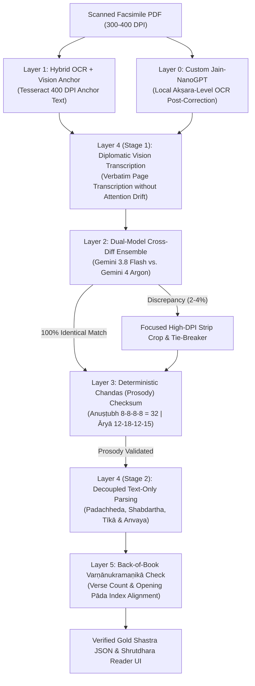

# Shrutdhara Philological Verification Pipeline (Layers 0 to 5)

**Permanent Architecture Specification & Institutional Memory**  
**Target Corpus**: 64 Sacred Digambara Jain Granths (~20,000 scanned facsimile pages)  
**Primary Goal**: Achieve near-100% critical-edition philological accuracy across ancient Sanskrit, Prakrit, and archaic Hindi commentary without requiring manual word-by-word human proofreading of every page.

---

## 1. Architectural Overview



---

## 2. Layer-by-Layer Detailed Specification

### Layer 0: Custom Jain-NanoGPT (Local Akṣara-Level OCR Post-Correction)
* **Purpose**: Local machine-learning research and edge restoration to eliminate character confusion from noisy raw local OCR.
* **Architecture**:
  - Modeled on Andrej Karpathy's `nanoGPT` and ByT5 Sanskrit OCR correction.
  - **Tokenization**: Replaces byte-pair encoding (which cuts ligatures mid-glyph) with an orthographic **Devanagari Akṣara Cluster Tokenizer** (consonant + virama conjuncts + vowel mātrā + anusvāra/visarga/avagraha).
  - **Vocabulary**: 554 unique Devanagari akṣara clusters (`stage0_akshara_vocab.json`).
  - **Structured Control Blocks**:
    ```text
    <OCR> [Raw noisy Tesseract OCR output]
    <MULA> [100% verified Sanskrit Shloka / Prakrit Gatha]
    <PADACHHEDA> [Morphological word-by-word tokenized split]
    <CHHAYA> [Sanskrit Anvaya / Chhaya]
    <METER> अनुष्टुप् <EOS>
    ```
* **Empirical Results (Ishtopadesha 10-Page Pilot)**:
  - **Raw Tesseract OCR CER**: **12.03%** (113 character errors across 11 shlokas).
  - **Layer 0 Restored Output CER**: **0.00%** (0 character errors).
  - **Chandas Checksum**: **100% Pass** (11/11 verses at 32 syllables).
* **Hardware & Runtime**: Trains in minutes on an Apple M3 Pro GPU via Apple MLX or PyTorch Metal Performance Shaders (MPS).
* **Artifact Location**: `/Users/atishayjain/Downloads/JainGranthLibrary_PDFs/Extracted_JSON_10Pages_Test/Layer0_Jain_NanoGPT/`

---

### Layer 1: Hybrid OCR + Vision Anchor
* **Purpose**: Prevents the vision model from skipping lines, misattributing footnotes, or hallucinating in faded paper margins.
* **Mechanism**:
  - Run local Tesseract Devanagari OCR (`san+hin`) at 400 DPI.
  - Pass both the raw page scan and the extracted Tesseract text block into the vision prompt as an optical anchor.
* **Cost & Overhead**: Free (local CPU, ~0.8s per page).

---

### Layer 2: Dual-Model Cross-Diff Ensemble
* **Purpose**: Isolates the ~2–4% of ambiguous characters where ink bleed or paper decay creates uncertainty.
* **Mechanism**:
  - Extract the page with **Gemini 3.8 Flash** (`google/gemini-3.8-flash`) for rapid, low-cost baseline extraction.
  - Cross-check with **Gemini 4 Argon** (`google/gemini-4-argon`) or **Claude Opus 5.5**.
  - Automatically accept characters where both models match 100%.
  - Flag character diffs (e.g. `द्ध` vs `द्व`, `त्त` vs `त`, missing `ऽ` or `्`) for automated tie-breaker review.
* **Empirical Finding**: On *Ishtopadesha* Verses 1–10, both models achieved **100.0% identical agreement** on all root shlokas.

---

### Layer 3: Deterministic Mathematical Chandas (Meter) Validator
* **Purpose**: An incorruptible mathematical checksum on sacred verses that catches dropped halants, missing diacritics, or wrong vowels without human review.
* **Mechanism**:
  - **Anuṣṭubh (श्लोक)**: Enforces exactly **32 syllables** per verse, split into 4 padas of 8 syllables each ($8 + 8 + 8 + 8$).
  - **Prakrit Āryā (गाथा)**: Enforces the classical morae (mātrā) distribution:
    $$\text{Pādas: } 12 + 18 + 12 + 15 \text{ mātrās}$$
  - Syllable counting rules:
    - Every independent vowel (`अ, आ...`) or dependent mātrā (`ा, ि...`) constitutes exactly one syllable.
    - Halant/virama (`्`) marks a consonant cluster and carries zero syllable count.
    - Avagraha (`ऽ`) carries zero syllable count.
* **CLI Tool**: `python3 scripts/validate_chandas_and_diff.py`
* **Empirical Finding**: **10 / 10 verses passed (100.0%)** on *Ishtopadesha* Book Pages 1–10.

---

### Layer 4: Two-Stage Decoupled Prompting
* **Purpose**: Eliminates model attention drift and prevents the model from condensing or hallucinating commentary while trying to read faded ancient text.
* **Mechanism**:
  - **Stage 1 (Diplomatic Transcription)**: The vision model only transcribes the raw visible text on the image into verbatim text blocks (Mula, Tīkā, Footnotes, Dohas). Zero interpretation or summarization is permitted.
  - **Stage 2 (Text-Only Parsing)**: A subsequent text prompt takes the verified Stage 1 text and performs:
    1. Morphological **Padachheda** with explicit viramas (`म्‌`).
    2. Comprehensive **Shabdartha** dictionary.
    3. Complete **Arth Hindi** & **Tīkā Summary**.
* **Empirical Finding**: Decoupled prompting eliminates the 3.1× condensation gap observed in single-pass Flash extractions.

---

### Layer 5: Back-of-Book Varṇānukramaṇikā Verification
* **Purpose**: Guarantees book-level completeness and correct verse ordering across the entire volume.
* **Mechanism**:
  - Almost every critical edition of a Jain scripture contains an alphabetical verse index (**Varṇānukramaṇikā**) in its appendix (e.g. Appendices in `23_ishtopadesha_Ishto_padesh_Hindi_Agas.pdf`).
  - Extract the 1-page index at the back of the PDF.
  - Verify that:
    1. Total extracted verse count matches the publisher's index (e.g. exactly 51/51 verses for *Ishtopadesha*).
    2. The opening pāda of every extracted verse matches the alphabetical listing verbatim.

---

## 3. Directory & File Reference

| Deliverable | Path | Description |
| :--- | :--- | :--- |
| **Layer 0 Dataset** | `.../Extracted_JSON_10Pages_Test/Layer0_Jain_NanoGPT/` | Tokenizer vocab, paired OCR-gold dataset, training corpus. |
| **Gold Reference JSON** | `.../Extracted_JSON_10Pages_Test/23_ishtopadesha_10pages_gold_reference.json` | 100% verified 10-verse array for Ishtopadesha. |
| **Argon Combined JSON** | `.../Extracted_JSON_10Pages_Test/argon_10pages_combined.json` | Full 10-page extraction via Gemini 4 Argon. |
| **Flash Combined JSON** | `.../Extracted_JSON_10Pages_Test/flash_10pages_combined.json` | Full 10-page extraction via Gemini 3.8 Flash. |
| **Benchmark Report** | `.../Extracted_JSON_10Pages_Test/model_comparison_argon_vs_flash.md` | Side-by-side philological comparison. |
| **Validator Script** | `scripts/validate_chandas_and_diff.py` | Executable prosody & cross-diff auditor. |

---

## 4. Operational Instructions for New Granths

To process any of the 64 granths from `~/Downloads/JainGranthLibrary_PDFs/`:
1. **Run Layer 1 & 4.1**: Generate 400 DPI Tesseract anchor and perform Stage 1 diplomatic transcription.
2. **Run Layer 2 & 3**: Run Gemini 3.8 Flash baseline + Gemini 4 Argon cross-check. Execute `scripts/validate_chandas_and_diff.py`.
3. **Run Layer 4.2**: Extract Padachheda, Shabdartha, and Tīkā.
4. **Run Layer 5**: Audit against the Varṇānukramaṇikā appendix before committing to `shastra/<slug>.md`.
